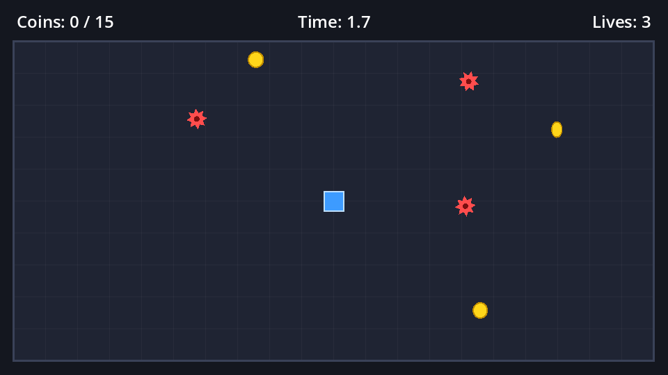
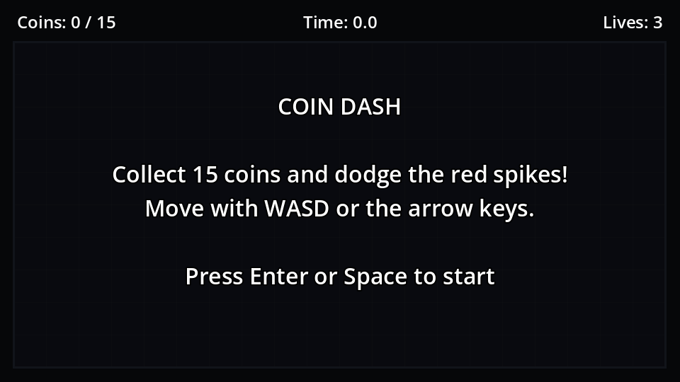
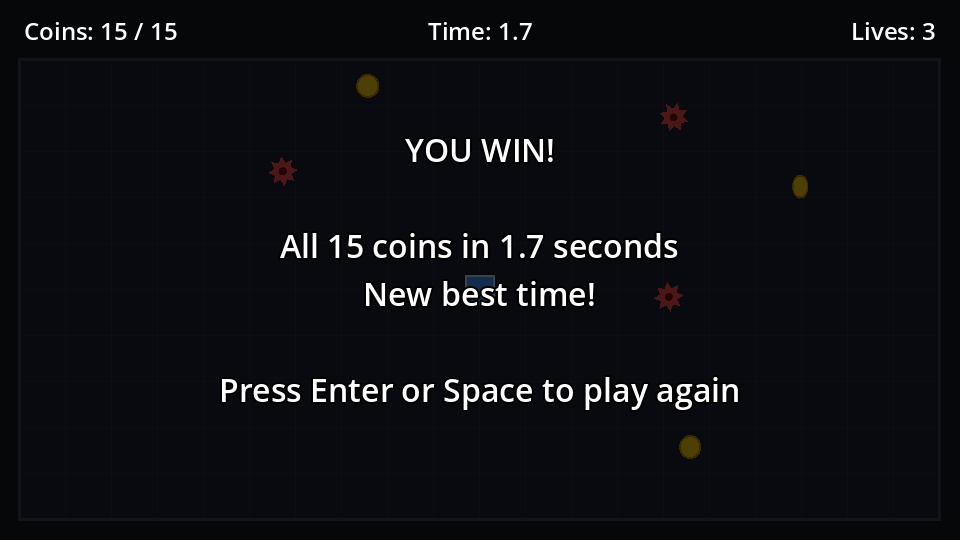

# Coin Dash

A small top-down arcade game made with [Godot 4](https://godotengine.org/). Collect 15 coins before the red spiky balls take your three lives.



No art or sound files: everything is drawn in code, so the whole project is plain text you can read, diff and change.

## Play

1. Install Godot 4.7 or newer (the standard version, not the .NET one) from [godotengine.org](https://godotengine.org/download).
2. Start Godot, click **Import**, and pick `project.godot` in this folder.
3. Press **F5** to play. (Or from a terminal in this folder: `godot --path .`)

| Key | Action |
| --- | ------ |
| W A S D or arrow keys | Move |
| Enter or Space | Start, and play again |

How it plays:

- Coins appear every second (up to 3 on screen). Touch one to collect it.
- You start with 1 hazard, and another appears every 4th coin.
- A hit costs a life, and you blink for 1.5 seconds during which you can't be hit again.
- Collect 15 coins to win. Lose all 3 lives and it's game over. Your best winning time is shown for the session.

| Title | Win |
| ----- | --- |
|  |  |

## How the project is organised

```text
scenes/
    main.tscn     the game: arena, player, HUD, and a container for coins and hazards
    player.tscn   CharacterBody2D with a square collision shape
    coin.tscn     Area2D with a circle collision shape
    hazard.tscn   Area2D with a circle collision shape
    hud.tscn      CanvasLayer with the score, time and lives text and the centre message
scripts/
    main.gd       the "game manager": score, lives, game state, spawning
    player.gd     movement, staying inside the arena, blinking after a hit
    coin.gd       spins; says "collected" when the player touches it
    hazard.gd     bounces around; says "hit" while the player touches it
    hud.gd        updates the text on screen
tools/
    smoke_test.gd   automated check of the game rules (see below)
    screenshot.gd   saves the pictures in docs/
    zip_web_build.py   zips the web export for itch.io (see below)
export_presets.cfg   the "Web" export settings
```

The idea behind the split: `coin.gd` and `hazard.gd` know nothing about score or lives. They only emit a *signal* (`collected`, `hit`) when the player touches them, and `main.gd` decides what that means. That keeps the rules in one place.

## Automated test

`tools/smoke_test.gd` plays the game without a window: it presses start, holds a movement key, drops coins and hazards onto the player, and checks the score, lives and game state after each step.

```bash
godot --headless --path . --script res://tools/smoke_test.gd
```

It prints one line per check. The exit code is 0 if everything passed, otherwise the number of failed checks. Output of the last run:

```text
PASS  the game starts on the title screen
PASS  the title message is shown
PASS  the player is hidden behind the title text
PASS  pressing start begins the game
PASS  a round starts with 3 lives and 0 coins
PASS  a round starts with 1 hazard
PASS  the message is hidden while playing
PASS  the player is visible while playing
PASS  holding right for 0.3 s moves ~90 px (moved 90)
PASS  the player cannot leave the play area
PASS  touching a coin scores 1 (score is 1)
PASS  the HUD shows the new score
PASS  touching a hazard costs a life (lives is 2)
PASS  the player is invulnerable right after a hit
PASS  no second hit while invulnerable (lives is 2)
PASS  a hazard that stays put hurts again when the blinking ends (lives is 1)
PASS  losing the last life ends the round
PASS  the game over message is shown
PASS  the player cannot move after the round ends
PASS  start begins a new round after game over
PASS  the new round resets lives and score
PASS  the new round has exactly 1 hazard
PASS  the new round has exactly 1 coin
PASS  a hazard turns around at the right wall
PASS  a hazard stays inside the play area
PASS  collecting 15 coins wins (score is 15)
PASS  the win message is shown
PASS  the winning time is remembered
PASS  a new hazard appears every 4th coin (1 + 3 = 4)
29 checks, 0 failed
```

To retake the screenshots in `docs/` (this opens a game window for a couple of seconds, so don't add `--headless`):

```bash
godot --path . --script res://tools/screenshot.gd
```

## Export for itch.io

The project includes a ready "Web" export preset (`export_presets.cfg`). It makes a single-threaded build, so it runs on itch.io without any special server settings.

1. One time only: install the Web export templates that match your Godot version (in Godot: **Editor > Manage Export Templates > Download and Install**).
2. From this folder, export the game and zip it:

```bash
godot --headless --path . --export-release "Web" build/web/index.html
python tools/zip_web_build.py
```

This writes `build/coin-dash-web.zip` (about 10 MB). The `build/` folder is not kept in git.

To try the build on your own computer before uploading, serve the folder over HTTP (browsers will not run it from a `file://` address) and open http://localhost:8060:

```bash
python -m http.server 8060 --directory build/web
```

On itch.io: **Create new project**, set *Kind of project* to **HTML**, upload `coin-dash-web.zip` and tick **This file will be played in the browser**. Set the viewport size to **960 x 540** and tick **Fullscreen button**.

## Ideas for next steps

- Sound effects and a few particles when you collect a coin.
- A high score that is saved between runs (`FileAccess` or `ConfigFile`).
- A second kind of coin or a power-up, such as a shield.

## Licence

MIT, see [LICENSE](LICENSE).
